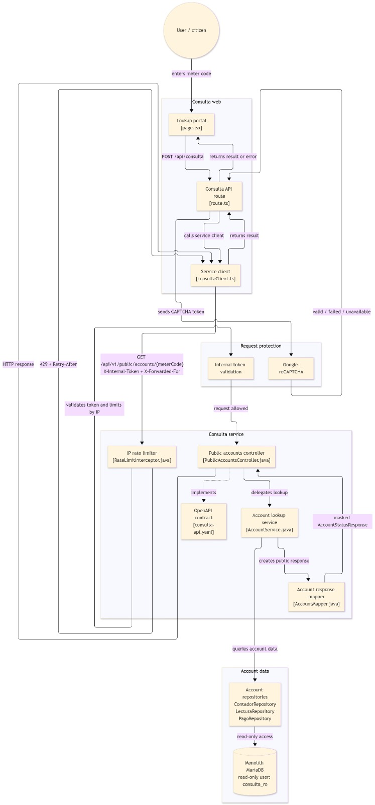
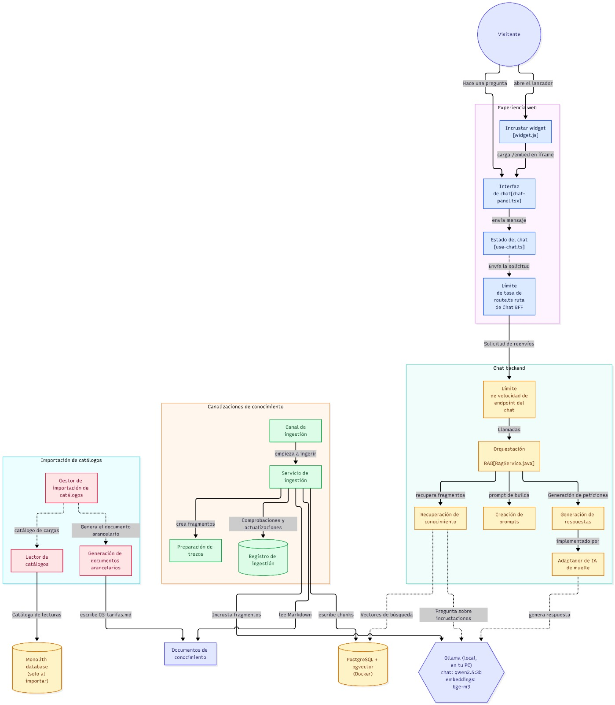
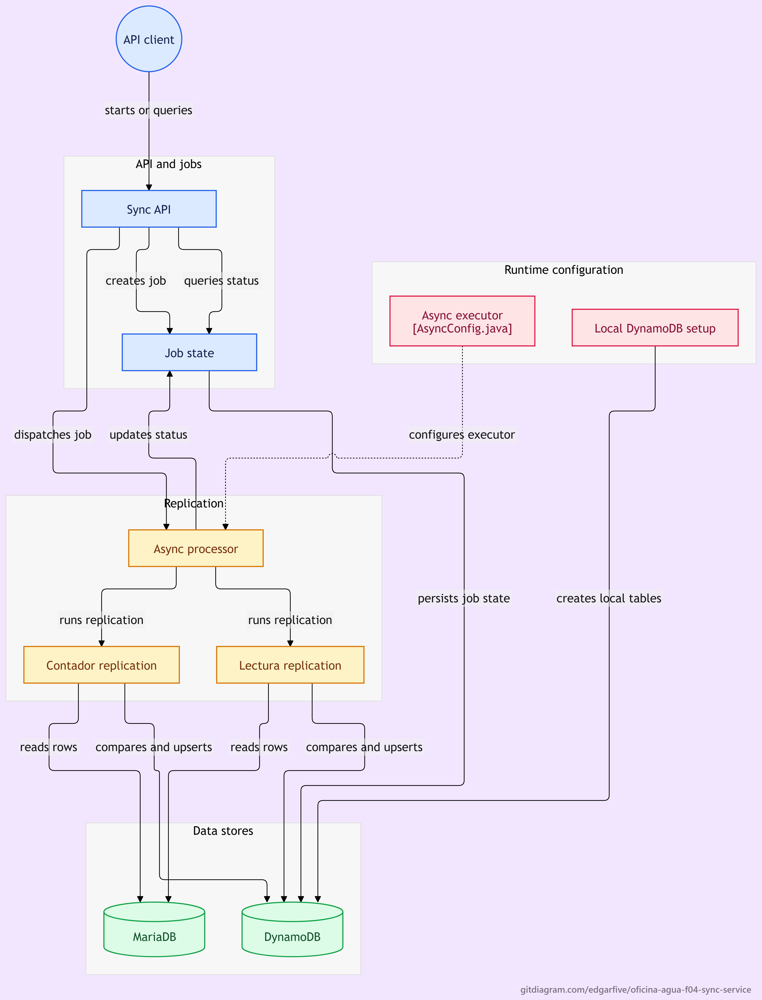

Nombre: Edgar Guillermo Chinchilla Chinchilla  
Carnet: 0905-23-13243  
Repositorio: https://github.com/EdgarFive/oficina-agua-f04-sync-service  
Modulo asignado: Replicación asíncrona a NoSQL | SQL

# Oficina del Agua — Fase 2 · Feature 04

**Microservicio de replicación asíncrona desde MariaDB hacia DynamoDB Local**, implementado en Java 17 y Spring Boot.

La Fase 2 comprende cuatro módulos. Las Features 01 y 02 se presentan de manera conjunta, mientras que las Features 03 y 04 se ejecutan de forma independiente. Este repositorio contiene la implementación y el entorno de ejecución de la **Feature 04**. No incluye un despliegue unificado de los cuatro módulos.

## 1. Contexto y arquitectura de Fase 2

El sistema original de la Oficina del Agua permite administrar clientes, contadores, lecturas, pagos, tarifas, servicios y usuarios. El monolito del equipo está desarrollado con **PHP, CodeIgniter 4 y MariaDB**. Su repositorio es [sistema-oficina-agua](https://github.com/Dany164/sistema-oficina-agua). El sistema existente se mantiene sin modificaciones en el alcance de esta feature.

La Fase 2 contempla cuatro funcionalidades:

| Módulo | Responsabilidad dentro de la Fase 2 | Modalidad de presentación |
| --- | --- | --- |
| **Feature 01 — Consulta pública con captcha** | Facilitar consultas públicas con un mecanismo de verificación. | Junto con F02. |
| **Feature 02 — Chatbot con RAG** | Permitir consultas asistidas mediante recuperación de información. | Junto con F01. |
| **Feature 03 — Envío de pagos por colas** | Gestionar el envío de pagos mediante mensajería hacia sistemas externos. | Independiente. |
| **Feature 04 — Replicación asíncrona a NoSQL** | Leer datos seleccionados de MariaDB y replicarlos a DynamoDB Local mediante trabajos asíncronos. | Independiente; implementada en este repositorio. |

### 1.1. Vista general y alcance real


El monolito utiliza MariaDB como base de datos transaccional. La Feature 04 consulta esa base con una cuenta SQL de solo lectura y escribe una réplica parcial en DynamoDB Local. El diagrama sitúa las cuatro features dentro del alcance académico de la Fase 2; no representa comunicaciones implementadas entre F04 y las otras tres features.

### 1.2. Diagramas de las features

#### Feature 01 — Consulta pública con captcha



#### Feature 02 — Chatbot con RAG



#### Feature 03 — Envío de pagos por colas

Esta funcionalidad forma parte de la arquitectura general de Fase 2. Su ejecución es independiente y su implementación no está contenida en este repositorio.

#### Feature 04 — Replicación asíncrona a NoSQL



## 2. Feature 04 — Objetivo y funcionamiento

El objetivo de la Feature 04 es replicar **contadores y lecturas** desde la base SQL original hacia una base NoSQL independiente. De este modo se dispone de una copia para posibles consultas o reportes posteriores sin realizar escrituras en el origen. Esta feature **no implementa un panel de reportes ni realiza actualizaciones automáticas cada vez que cambia MariaDB**: el proceso inicia cuando se solicita la sincronización por API.

### 2.1. Diagrama técnico del módulo


**Flujos del diagrama:**

1. Un cliente, PowerShell o Swagger UI llama a `POST /api/sync/resumen`.
2. `SyncController` solicita crear un job a `SyncJobService`, que lo guarda con estado `PENDIENTE` en DynamoDB.
3. `AsyncSyncProcessor` procesa el trabajo mediante `@Async("syncExecutor")`. El controlador responde **HTTP 202** sin esperar a que finalice la replicación.
4. El procesador cambia el estado a `EN_PROGRESO`, ejecuta **primero contadores y luego lecturas**, y finalmente marca `COMPLETADO` si ambas operaciones terminan sin excepción.
5. Si ocurre una excepción, el procesador **intenta** registrar `FALLIDO`; los registros copiados antes del error no se revierten.
6. Un cliente puede consultar `GET /api/sync/jobs/{jobId}` para conocer el último estado guardado.

### 2.2. Tablas replicadas

| Origen MariaDB (solo lectura) | Destino DynamoDB Local | Identificador del registro |
| --- | --- | --- |
| `tb_contadores` | `oficina_agua_contadores` | `contador_id` |
| `tb_lecturas` | `oficina_agua_lecturas` | `lectura_id` |
| — | `oficina_agua_sync_jobs` | `jobId` (UUID de tipo texto) |

El componente `ContadorReplicationService` usa `JdbcTemplate` para consultar contadores y el componente `LecturaReplicationService` hace lo mismo con lecturas. Se usan los atributos numéricos correspondientes; en lecturas se utiliza `BigDecimal` para preservar valores decimales al convertirlos para DynamoDB.

### 2.3. Comparación y escritura (`diff + upsert`)

Para cada registro de MariaDB se busca su equivalente en DynamoDB mediante su clave primaria:

- **No existe:** se inserta con `putItem()`.
- **Existe y los atributos difieren:** se reemplaza con `putItem()`.
- **Existe y es igual:** no se vuelve a escribir.

El proceso **no elimina registros** en DynamoDB. Por ello, si se elimina un registro del origen, la copia previa podría permanecer en el destino. Cada nuevo job vuelve a comparar el estado actual de los registros que sí existen en MariaDB.

### 2.4. Endpoints y contrato

El contrato fuente está definido en [`openapi/sync-api.yaml`](openapi/sync-api.yaml). OpenAPI Generator produce la interfaz `ApiApi` y el modelo `SyncJobResponse`; el controlador implementa las operaciones.

| Método | Ruta | Resultado |
| --- | --- | --- |
| `POST` | `/api/sync/resumen` | `202 Accepted`, `jobId`, `estado: PENDIENTE`. |
| `GET` | `/api/sync/jobs/{jobId}` | `200 OK` con el estado; `404` si el identificador no existe. |

Estados: `PENDIENTE`, `EN_PROGRESO`, `COMPLETADO` y `FALLIDO`.

**Interfaz de pruebas:** abrir `http://localhost:8081/swagger.html` después de iniciar el servicio. Este HTML utiliza Swagger UI desde un CDN, por lo que **necesita conexión a Internet** para cargar sus recursos. La interfaz incluye una copia del contrato; si se cambian los endpoints, se debe mantener coherente con `openapi/sync-api.yaml`.

### 2.5. Integración y responsabilidades

- **Monolito PHP/CodeIgniter 4:** continúa a cargo del registro y administración del negocio; no se modificó su código para la Feature 04.
- **MariaDB original:** base de origen. Se consulta con el usuario `f04_local_ro`, limitado a lecturas.
- **Spring Boot / Feature 04:** servicio independiente que expone la API REST, coordina jobs, consulta datos SQL y escribe réplicas NoSQL.
- **DynamoDB Local:** almacena contadores, lecturas y estados de jobs en tablas distintas; su información persiste mediante un volumen Docker.
- **Otras features:** no existe una llamada directa implementada desde F04 hacia F01, F02 o F03; no se atribuyen comunicaciones no verificadas.

### 2.6. Decisiones técnicas

**Spring `@Async` y estados persistentes:** se optó por responder `202` y devolver un identificador, en lugar de bloquear el cliente hasta terminar toda la replicación. El endpoint GET permite comprobar el resultado posteriormente.

**`diff + upsert` en lugar de sobrescribir todo en cada ejecución:** evita escrituras cuando los atributos no cambiaron y satisface el requisito de no ejecutar eliminaciones. No constituye una transacción global: si hay un error, algunas escrituras pueden haber sucedido.

**Integración por lectura de la base original:** se decidió conectar directamente la Feature 04 a la MariaDB existente, sin alterar el monolito ni crear endpoints nuevos dentro de su código. El usuario SQL de solo lectura reduce el riesgo de cambios accidentales en el origen.

**Docker para el servicio y NoSQL:** permite ejecutar Java y DynamoDB con una configuración aislada, manteniendo persistente la información replicada. La base principal puede continuar fuera de Docker.

## 3. Ejecución y verificación de la Feature 04

El despliegue implementado utiliza la base de datos original `oficina_agua` de MariaDB ejecutada en Windows y dos contenedores de Docker Compose: `sync-service` (Spring Boot) y `dynamodb` (DynamoDB Local). La base SQL original es externa a Docker; el repositorio no inicia una segunda instancia de MariaDB.

### 3.1. Requisitos y configuración

Se requiere Java únicamente para las operaciones locales de desarrollo; el entorno Docker ejecuta la aplicación con Java 17. Para la operación principal se necesita:

- Docker Desktop con Docker Compose.
- MariaDB con el esquema del sistema original `oficina_agua`, accesible desde los contenedores en el puerto `3308` del equipo anfitrión.
- Usuario de solo lectura `f04_local_ro` autorizado para consultar `tb_contadores` y `tb_lecturas`.
- Un archivo privado `.env.docker` con la contraseña del usuario SQL, excluido del control de versiones.
- Conexión a Internet para cargar los recursos externos de Swagger UI.

El código del sistema existente y las instrucciones para crear su esquema pueden consultarse en el [repositorio del monolito](https://github.com/Dany164/sistema-oficina-agua).

En Windows, comprobar que MariaDB está escuchando:

```powershell
Test-NetConnection 127.0.0.1 -Port 3308
```

El resultado esperado es `TcpTestSucceeded : True`. La configuración de MariaDB debe permitir también la conexión desde Docker Desktop.

Crear `.env.docker` en la raíz del repositorio:

```dotenv
F04_LOCAL_DB_PASSWORD=ASIGNAR_CONTRASENA_LOCAL
```

La contraseña real no debe publicarse. El archivo `docker-compose.yml` configura la conexión JDBC a `jdbc:mariadb://host.docker.internal:3308/oficina_agua` y el destino NoSQL a `http://dynamodb:8000` dentro de la red de Docker Compose.

### 3.2. Iniciar los servicios

Con MariaDB ejecutándose en Windows y Docker Desktop abierto, ejecutar desde la carpeta raíz del repositorio:

```powershell
docker compose --env-file .env.docker up -d --build
docker compose --env-file .env.docker ps
```

Deben aparecer los servicios `sync-service` y `dynamodb`. Las direcciones publicadas son:

| Servicio | Acceso desde Windows |
| --- | --- |
| API de Spring Boot | `http://localhost:8081` |
| Swagger UI | `http://localhost:8081/swagger.html` |
| DynamoDB Local | `http://localhost:8001` |

Para consultar el inicio de la aplicación y la conexión a las bases:

```powershell
docker compose --env-file .env.docker logs --tail=80 sync-service
```

### 3.3. Ejecutar y consultar una sincronización

1. Abrir `http://localhost:8081/swagger.html` en el navegador.
2. Desplegar **POST `/api/sync/resumen`**, seleccionar **Try it out** y **Execute**.
3. Comprobar la respuesta **HTTP 202 Accepted** con un `jobId` y estado inicial `PENDIENTE`.
4. Desplegar **GET `/api/sync/jobs/{jobId}`**, introducir el identificador real y ejecutar.
5. Comprobar que el estado pase a `COMPLETADO` cuando terminen las replicaciones; `FALLIDO` identifica un error de ejecución.

El mismo flujo puede ejecutarse desde PowerShell:

```powershell
$job = Invoke-RestMethod -Method Post -Uri 'http://localhost:8081/api/sync/resumen'
$job
Invoke-RestMethod -Uri "http://localhost:8081/api/sync/jobs/$($job.jobId)"
```

La salida de la sincronización se encuentra en los registros del contenedor:

```powershell
docker compose --env-file .env.docker logs --tail=150 sync-service
```

Los mensajes `SINCRONIZACION DE CONTADORES` y `SINCRONIZACION DE LECTURAS` indican cuántos registros fueron insertados, actualizados o permanecieron sin cambios.

**Resultado de una ejecución comprobada:** se procesaron 20 contadores (18 insertados y 2 actualizados) y 104 lecturas (102 insertadas y 2 actualizadas). El job finalizó en estado `COMPLETADO`. Los valores pueden variar en nuevas ejecuciones según el contenido previo de DynamoDB.

### 3.4. Detener los servicios

```powershell
docker compose --env-file .env.docker down
```

Este comando detiene Spring Boot y DynamoDB sin eliminar sus volúmenes persistentes. MariaDB, al ejecutarse fuera de Docker, se detiene de forma independiente en Windows. No se utiliza la opción `down -v` para conservar los datos almacenados.

## 4. Código y componentes principales

| Archivo | Función |
| --- | --- |
| [`openapi/sync-api.yaml`](openapi/sync-api.yaml) | Contrato OpenAPI de POST y GET. |
| `src/main/java/com/oficinaagua/syncservice/controller/SyncController.java` | Controlador HTTP; usa la interfaz generada `ApiApi`. |
| `src/main/java/com/oficinaagua/syncservice/service/SyncJobService.java` | Guarda, lee y actualiza trabajos en DynamoDB. |
| `src/main/java/com/oficinaagua/syncservice/service/AsyncSyncProcessor.java` | Ejecuta las replicaciones en segundo plano y gestiona el estado. |
| `src/main/java/com/oficinaagua/syncservice/service/ContadorReplicationService.java` | Lee y replica `tb_contadores`. |
| `src/main/java/com/oficinaagua/syncservice/service/LecturaReplicationService.java` | Lee y replica `tb_lecturas`. |
| `src/main/java/com/oficinaagua/syncservice/config/DynamoDbLocalConfig.java` | Conexión y preparación de tablas DynamoDB Local. |
| [`src/main/resources/static/swagger.html`](src/main/resources/static/swagger.html) | Documentación interactiva para pruebas de los endpoints. |
| `Dockerfile` | Compilación Maven y ejecución de Java 17 en una imagen. |
| `docker-compose.yml` | Ejecuta F04 y DynamoDB, conectados a la MariaDB original de Windows. |

## 5. Seguridad y alcance de la implementación

- El archivo `.env.docker` está excluido por `.gitignore`; las credenciales se proporcionan únicamente durante la ejecución local y no forman parte de la documentación.
- Las claves de acceso, tokens y contraseñas no se incluyen en el código fuente ni deben incorporarse al historial del repositorio.
- La conexión SQL de F04 usa permisos de solo lectura; se preserva el monolito heredado.
- DynamoDB utilizado es **DynamoDB Local** en Docker, **no** el servicio administrado de AWS.
- La sincronización es por solicitud y puede dejar una copia parcialmente actualizada si ocurre un error durante el job.
- Los contenedores de este repositorio **no ejecutan conjuntamente** las Features 01, 02 y 03 ni el monolito PHP.
- Swagger UI usa recursos de un CDN; la interfaz visual depende de que esos recursos estén disponibles.
